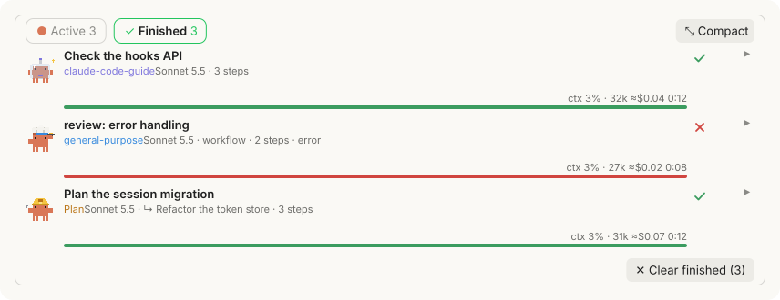
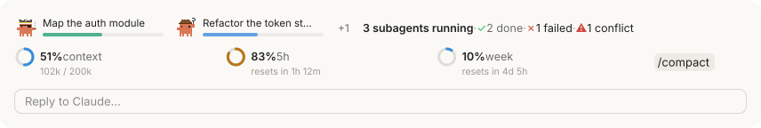

<h1 align="center">agent-crew</h1>

<p align="center">
  A <a href="https://claude.com/claude-code">Claude Code</a> mod that shows what your subagents are doing, which files they touch, what the session costs, and how much of your context and plan limits is left.
</p>

<p align="center">
  
  
  
</p>

<p align="center">
  
</p>

## Contents

- [Overview](#overview)
- [Install](#install)
- [Sections](#sections)
  - [Usage](#usage)
  - [Cost](#cost)
  - [Subagents](#subagents)
  - [Timeline](#timeline)
  - [Files](#files)
  - [Above the prompt](#above-the-prompt)
- [Settings](#settings)
- [How it works](#how-it-works)
- [Development](#development)
- [Acknowledgements](#acknowledgements)
- [License](#license)

## Overview

`/crew` opens a single pane that follows everything the session's crew does. It records every subagent, whichever way it was started, and draws each one as a pixel crab in the costume of its type:

<p align="center">
  
</p>

Each type has a colour of its own: Claude Code's types a fixed one, any other type the next free one when it first shows up.

The pane is built from framed sections. Each one can be switched on or off in the [settings](#settings):

| Section | Content | Default |
| --- | --- | --- |
| [Usage](#usage) | Context fill, 5-hour and weekly limit | On |
| [Cost](#cost) | Main chat and subagents separately, with a total | Off |
| [Subagents](#subagents) | Every agent in *Active* and *Finished* tabs, with details | On |
| [Timeline](#timeline) | When the main chat worked and each agent ran | On |
| [Files](#files) | Files read, changed and committed, with diffs | On |

## Install

Inside Claude Code:

```
/plugin marketplace add jduerrmann/agent-crew
/plugin install agent-crew@agent-crew
```

Or from a terminal:

```bash
claude plugin marketplace add jduerrmann/agent-crew
claude plugin install agent-crew@agent-crew
```

Then run `/crew`. By default the pane also opens by itself, once a session, when the first file is read or changed or the first subagent starts.

## Sections

### Usage

<p align="center">
  
</p>

- **Context:** how full the session's context window is, in percent and tokens.
- **5-hour and weekly limit:** your plan's limits, each with the time until it resets.
- **Thresholds:** rings turn amber from 80 % and red from 95 %. A notice appears when a limit passes 80 % and 95 %, and when the context passes 85 %.
- **`/compact`:** compacts the conversation without leaving the pane.

Each meter can be hidden on its own in the *Usage* group of the settings.

### Cost

<p align="center">
  
</p>

- **Main chat and subagents** separately, each with its estimated cost and its share of the total.
- **New and cached tokens** separately. Every request rereads the whole context, mostly from the cache. *New* counts input, output and cache writes; *cached* counts what was read from the cache. A long-running agent therefore does not appear to use millions of new tokens.
- **Total** of both, including agents that were cleared from the list.

The section is off by default. Costs are estimated from token counts and a price table; they are not a bill.

### Subagents

<p align="center">
  
</p>

- **Coverage:** Agent-tool subagents of any type, forks, teammates, background agents, workflow agents, and nested agents under their parent.
- **Tabs:** *Active* and *Finished*. A finished parent stays in *Active* while one of its children is still running.
- **Rows:** model, effort, steps so far, the agent's latest action, context fill, estimated cost and run time.
- **Bar:** Claude Code reports no progress for subagents, so while an agent runs its bar is an estimate from run time and model requests. It fills quickly at first, then ever more slowly, and stops short of 90 %. A worker that reports its steps through [savvy-progress](https://github.com/johnnyvizz/claude-kit/tree/main/plugins/savvy-progress)'s `step` tool fills the bar for real (`3/5 · writing tests`). Finished agents get a full bar: green when done, red when failed, grey when stopped.
- **Details:** expanding a row shows the agent's task, its recent tool calls and messages, the files it read and changed, and its final answer. *Highlight its files* dims every other file in the tree.
- **Notifications** when background or workflow agents finish, and whenever an agent fails or is stopped.
- **Clear finished**, under the *Finished* tab, removes finished agents from the list. Their cost remains in the totals.

<p align="center">
  
</p>

**Compact mode** folds the section into two rows of crabs, one for active and one for finished agents, with a badge for done, failed or stopped. The other sections are unaffected.

<p align="center">
  
</p>

### Timeline

<p align="center">
  
</p>

- **One time axis** for all agents: which ran when, and which ran in parallel.
- **The main chat** in a row at the top: each of its turns a bar in Claude's colour, red when a turn failed and faint when it was interrupted. `timelineMain` turns the row off.
- **Folded pauses:** any stretch longer than 90 seconds without a running agent is folded into a labelled break, so rounds of work an hour apart keep readable bars.

### Files

<p align="center">
  
</p>

A tree of every file the main chat or a subagent touched, plus every file git reports as changed:

- **Read** (purple ◉): from `Read`, `Grep` results and shell readers such as `cat`, `head`, `sed`, `rg` or `Get-Content`.
- **Changed** (orange ✎): with added and deleted lines from git.
- **New** (blue +): untracked, or staged as added and not yet committed.
- **Committed** (green ✓): with the short hash of the commit.
- **Deleted** (red ✗): gone from the working tree.
- **Recent activity:** a file that was just read, changed or committed shimmers in its colour for a few seconds; its folders open while it does, and shut again afterwards unless you opened them.
- **Search:** the search line narrows the tree to matching paths and opens the folders that hold them; Enter opens the first hit's details, × clears the line.
- **Agents:** coloured dots show which agents touched a file (up to six). *Highlight its files* in an agent's details dims every other file; the `◎ agent ✕` chip in the header lifts it.
- **Details:** clicking a file opens a card with its history (who read, changed or committed it, and when) and, when git sees changes, a second tab with its diff against `HEAD`, or its content if it is untracked.
- **Open:** double-clicking a file, or *Open* in its details, opens it in the app your system uses for that kind of file.
- **Folders:** folders start collapsed; clicking one expands or collapses it. A collapsed folder sums up what is inside it, at any depth, in the legend's colours (`✎2 +1 ✗1 ◉3`), with conflicts and the agents' dots. Double-clicking a folder shows only that folder.
- **Breadcrumbs:** under the search line, the main folder and the branch with how far it is ahead of or behind its upstream; once a folder is entered, the steps above it lead back up.
- **Header:** `▾ Files · N` folds the section; ⊞ expands every folder in view (⊟ collapses them again). In a narrow pane the filters wrap to a second line. Git is read again after every change and every ten seconds while the pane is open.
- **Conflicts:** when two agents change the same file within ten minutes, the file is marked and a notice appears. A commit resolves the mark.
- **Filters:** *Activity* (the default) shows what the session's agents read, changed or committed. *Changes* shows everything git reports as changed, whoever made it, including changes made by shell commands, which can't be traced to a file. *All* shows every file under the root besides, untouched ones without a sign (git's own list, or outside a repository a walk of at most 300 folders; 4000 files at most either way).

### Above the prompt

A band above the prompt keeps the crew in view while the pane is closed. Each line has its own option in the settings group *Above the prompt*:

<p align="center">
  
</p>


- **Crew** (on): on the desktop each running agent walks as its crab, followed by the finished and failed agents and conflicts. In the terminal, a pulsing dot in each running agent's colour stands in for its crab. It stays away until the first agent of the session.
- **Progress** (off): each running agent's name and bar beside its crab, as in its row.
- **Usage** (off): the pane's rings for context and limits, with the time until each limit resets, and a `/compact` button beside them. In the terminal they are small bars, and a value from 80 % is coloured.

A click on the band opens the pane. When a survey needs the band, the band steps aside. When another plugin draws a band of its own, such as savvy-progress during a flow, it stays beneath the crew's. The status line entry (`🦀 2 subagents running`) can be turned off as well.

## Settings

<p align="center">
  
</p>

Open the settings with `/crew-settings` or the *Settings* button at the top of the pane. They are grouped into *Sections*, *Usage*, *Above the prompt*, *General* and *Notifications*, followed by *Version*; every change applies immediately. The pane writes the same values as `/config`; they can also be set in `~/.claude/settings.json`:

```json
{ "pluginConfigs": { "agent-crew": { "options": { "showTotals": true, "showFiles": false } } } }
```

| Option | Default | Description |
| --- | --- | --- |
| `showUsage` | `true` | Usage section. |
| `showTotals` | `false` | Cost section: main chat and subagents separately, new and cached tokens, and the total. |
| `showAgents` | `true` | Subagents section. |
| `showTimeline` | `true` | Timeline section. |
| `timelineMain` | `true` | The main chat's turns in a row at the top of the timeline. |
| `showFiles` | `true` | Files section. |
| `usageContext` | `true` | Context meter in the usage section. |
| `usageFiveHour` | `true` | 5-hour limit in the usage section. |
| `usageWeek` | `true` | Weekly limits in the usage section. |
| `bandAgents` | `true` | Above the prompt: running, finished and failed agents and conflicts. A click opens the pane. |
| `bandProgress` | `false` | Above the prompt: each running agent with its bar. |
| `bandUsage` | `false` | Above the prompt: context and limits, with the time until they reset. |
| `statusLine` | `true` | The status line entry with the number of running agents. |
| `autoOpen` | `true` | Open the pane when the first subagent of a session starts. |
| `autoOpenFiles` | `true` | Open the pane when a file is first read or changed in a session, as filetree does. Either way the pane opens by itself once a session at most. |
| `language` | `auto` | `auto`, `de` or `en`. `auto` follows Claude Code's language setting, then the system locale. |
| `crabMotion` | `smooth` | How the crabs walk on the desktop. `smooth` redraws the pane four times a second while an agent runs, a flip book the desktop can't cut off. `light` redraws once a second, and the crabs' step starts over with each redraw. |
| `notifyAgents` | `background` | Notify when agents end: `off`, `failures`, `background` (background and workflow agents, and any failure or stop) or `all`. |
| `notifyVia` | `toast` | `toast` inside Claude Code, or `system` for the terminal's or operating system's notification. |
| `limitWarnings` | `true` | Warn at 80 % and 95 % of a limit and at 85 % context. |
| `warnConflicts` | `true` | Warn about conflicting edits. |
| `checkUpdates` | `true` | Look once a day for a new version on GitHub and say so. |

### Updates

A few seconds after a session starts, and at most once a day, agent-crew compares its version with the one published on GitHub; a check that fails is tried again within the hour. A new version is announced once, and shows as **↑ version** beside *Settings* at the top of the pane. The *Version* group of the settings checks on demand and, for a copy installed from the marketplace, updates it in place (`claude plugin marketplace update agent-crew`, then `claude plugin update agent-crew@agent-crew`) and reloads the plugins. For a copy loaded from a folder of its own, such as a working copy, it only points out that `git pull` in that folder brings the new version. `checkUpdates` turns the daily check off; the button still works.

## How it works

agent-crew is a Claude Code mod: a hooks module, without an MCP server or a background process.

- **Agents:** `agent.spawn` records every start, including workflow and nested agents. `turn.step` adds context, tokens and cost per model request; `turn.complete` sets the final status. `$.agent.list()` adds agents that started before the mod loaded.
- **Files:** `tool.call` records reads and writes for the main loop and every subagent. Git status, line counts and new commits come from `git` itself, after writes and every ten seconds while the pane is open.
- **Usage:** `session.measure` provides context and rate-limit figures.
- **Rendering:** the desktop app receives SVG with CSS-only animation that respects `prefers-reduced-motion`; the terminal receives the same content as text.

The price table used for cost estimates is in `plugins/agent-crew/hooks/register.tsx`.

## Development

```bash
claude plugin validate plugins/agent-crew
claude plugin test plugins/agent-crew
```

The pictures in `media/` are drawn by the mod itself from made-up sessions in `plugins/agent-crew/tests/media.test.ts`; `tests/render.ts` lays out what the desktop pane was handed. The steps to redraw them are in [workflow.md](knowledge-base/workflow.md#readme-pictures).

## Acknowledgements

agent-crew builds on two projects:

- **[savvy-progress](https://github.com/johnnyvizz/claude-kit/tree/main/plugins/savvy-progress)** and **[savvy-flow](https://github.com/johnnyvizz/claude-kit/tree/main/plugins/savvy-flow)** by [johnnyvizz](https://github.com/johnnyvizz): the agents panel, the pixel crabs and their costumes (`hooks/crab.ts`).
- **[filetree](https://github.com/data-goblin/claude-code-filetree)** by [Kurt Buhler](https://github.com/data-goblin): the idea of following file activity, the shimmer, the search line, and the parsing of shell commands (`hooks/files.ts`).

Both are MIT licensed. Their copyright notices are in [NOTICE](NOTICE), and the parts derived from them remain under MIT.

## License

[PolyForm Noncommercial 1.0.0](LICENSE.md). You may use, modify and share agent-crew for any noncommercial purpose, including personal, research, educational and non-profit use. Commercial use, such as selling it or using it to generate revenue, is not permitted. For commercial licensing, please open an issue.
