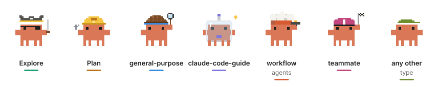
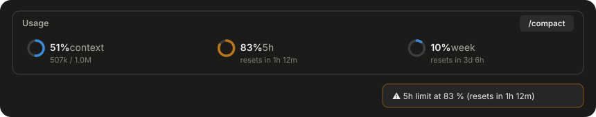
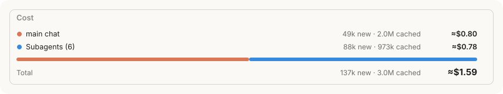
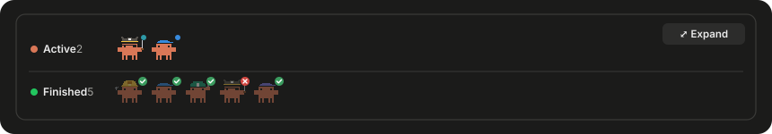
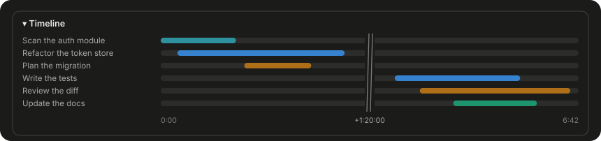
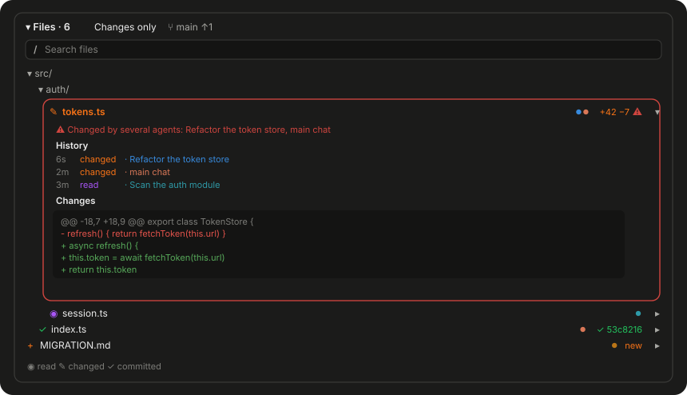
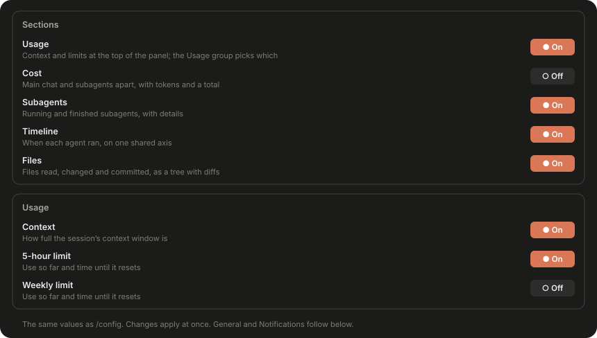

<h1 align="center">agent-crew</h1>

<p align="center">
  A <a href="https://claude.com/claude-code">Claude Code</a> mod that shows what your subagents are doing, which files they touch, what the session costs, and how much of your context and plan limits is left.
</p>

<p align="center">
  
  
  
</p>

<p align="center">
  
</p>

## Contents

- [Overview](#overview)
- [Install](#install)
- [Sections](#sections)
  - [Usage](#usage)
  - [Cost](#cost)
  - [Subagents](#subagents)
  - [Timeline](#timeline)
  - [Files](#files)
- [Settings](#settings)
- [How it works](#how-it-works)
- [Development](#development)
- [Acknowledgements](#acknowledgements)
- [License](#license)

## Overview

`/crew` opens a single pane that follows everything the session's crew does. It records every subagent, whichever way it was started, and draws each one as a pixel crab in the costume of its type:

<p align="center">
  
</p>

The pane is built from framed sections. Each one can be switched on or off in the [settings](#settings):

| Section | Content | Default |
| --- | --- | --- |
| [Usage](#usage) | Context fill, 5-hour and weekly limit | On |
| [Cost](#cost) | Main chat and subagents separately, with a total | Off |
| [Subagents](#subagents) | Every agent in *Active* and *Finished* tabs, with details | On |
| [Timeline](#timeline) | When each agent ran | On |
| [Files](#files) | Files read, changed and committed, with diffs | On |

## Install

Inside Claude Code:

```
/plugin marketplace add jduerrmann/agent-crew
/plugin install agent-crew@agent-crew
```

Or from a terminal:

```bash
claude plugin marketplace add jduerrmann/agent-crew
claude plugin install agent-crew@agent-crew
```

Then run `/crew`. By default the pane also opens by itself, once a session, when the first file is read or changed or the first subagent starts.

## Sections

### Usage

<p align="center">
  
</p>

- **Context:** how full the session's context window is, in percent and tokens.
- **5-hour and weekly limit:** your plan's limits, each with the time until it resets.
- **Thresholds:** rings turn amber from 80 % and red from 95 %. A notice appears when a limit passes 80 % and 95 %, and when the context passes 85 %.
- **`/compact`:** compacts the conversation without leaving the pane.

Each meter can be hidden on its own in the *Usage* group of the settings.

### Cost

<p align="center">
  
</p>

- **Main chat and subagents** separately, each with its estimated cost and its share of the total.
- **New and cached tokens** separately. Every request rereads the whole context, mostly from the cache. *New* counts input, output and cache writes; *cached* counts what was read from the cache. A long-running agent therefore does not appear to use millions of new tokens.
- **Total** of both, including agents that were cleared from the list.

The section is off by default. Costs are estimated from token counts and a price table; they are not a bill.

### Subagents

<p align="center">
  
</p>

- **Coverage:** Agent-tool subagents of any type, forks, teammates, background agents, workflow agents, and nested agents under their parent.
- **Tabs:** *Active* and *Finished*. A finished parent stays in *Active* while one of its children is still running.
- **Rows:** model, effort, the agent's latest action, context fill, estimated cost and run time.
- **Details:** expanding a row shows the agent's task, its recent tool calls and messages, the files it read and changed, and its final answer. *Highlight its files* dims every other file in the tree.
- **Notifications** when background agents finish and whenever an agent fails.
- **Clear finished** removes finished agents from the list. Their cost remains in the totals.

**Compact mode** folds the section into two rows of crabs, one for active and one for finished agents, with a badge for done, failed or stopped. The other sections are unaffected.

<p align="center">
  
</p>

### Timeline

<p align="center">
  
</p>

- **One time axis** for all agents: which ran when, and which ran in parallel.
- **Folded pauses:** any stretch longer than 90 seconds without a running agent is folded into a labelled break, so rounds of work an hour apart keep readable bars.

### Files

<p align="center">
  
</p>

A tree of every file the main chat or a subagent touched, plus every file git reports as changed:

- **Read** (purple): from `Read`, `Grep` results and shell readers such as `cat`, `head`, `sed`, `rg` or `Get-Content`.
- **Changed** (orange): with added and deleted lines from git, or *new* for untracked files.
- **Committed** (green): with the short hash of the commit.
- **Recent activity:** a file that was just read, changed or committed shimmers in its colour for a few seconds.
- **Search:** the search line narrows the tree to matching paths; Enter opens the first hit.
- **Agents:** coloured dots show which agents touched a file.
- **Details:** clicking a file shows its history (who read, changed or committed it, and when) and its diff against `HEAD`, or its content if it is untracked.
- **Open:** double-clicking a file, or *Open* in its details, opens it in the app your system uses for that kind of file.
- **Folders:** folders start collapsed; clicking one expands or collapses it, and a search expands every folder that holds a hit. Double-clicking a folder shows only that folder, with breadcrumbs under the search line, next to the branch, to go back up. ⊞ expands every folder in view (⊟ collapses them again), ↻ reads git again.
- **Conflicts:** when two agents change the same file within ten minutes, the file is marked and a notice appears. A commit resolves the mark.
- **Filters:** *Activity* (the default) shows every file the session's agents read or changed, plus what git reports as changed; *Changes* only what was changed; *All* every file under the root besides, untouched ones drawn quiet (git's own list, or a bounded walk outside a repository).

## Settings

<p align="center">
  
</p>

Open the settings with `/crew-settings` or the *Settings* button at the top of the pane. They are grouped into *Sections*, *Usage*, *General* and *Notifications*, and every change applies immediately. The pane writes the same values as `/config`; they can also be set in `~/.claude/settings.json`:

```json
{ "pluginConfigs": { "agent-crew": { "options": { "showTotals": true, "showFiles": false } } } }
```

| Option | Default | Description |
| --- | --- | --- |
| `showUsage` | `true` | Usage section. |
| `showTotals` | `false` | Cost section: main chat and subagents separately, new and cached tokens, and the total. |
| `showAgents` | `true` | Subagents section. |
| `showTimeline` | `true` | Timeline section. |
| `showFiles` | `true` | Files section. |
| `usageContext` | `true` | Context meter in the usage section. |
| `usageFiveHour` | `true` | 5-hour limit in the usage section. |
| `usageWeek` | `true` | Weekly limits in the usage section. |
| `autoOpen` | `true` | Open the pane when the first subagent of a session starts. |
| `autoOpenFiles` | `true` | Open the pane when a file is first read or changed in a session, as filetree does. |
| `language` | `auto` | `auto`, `de` or `en`. `auto` follows Claude Code's language setting, then the system locale. |
| `notifyAgents` | `background` | Notify when agents end: `off`, `failures`, `background` (background agents and any failure) or `all`. |
| `notifyVia` | `toast` | `toast` inside Claude Code, or `system` for the terminal's or operating system's notification. |
| `limitWarnings` | `true` | Warn at 80 % and 95 % of a limit and at 85 % context. |
| `warnConflicts` | `true` | Warn about conflicting edits. |

## How it works

agent-crew is a Claude Code mod: a hooks module, without an MCP server or a background process.

- **Agents:** `agent.spawn` records every start, including workflow and nested agents. `turn.step` adds context, tokens and cost per model request; `turn.complete` sets the final status. `$.agent.list()` adds agents that started before the mod loaded.
- **Files:** `tool.call` records reads and writes for the main loop and every subagent. Git status, line counts and new commits come from `git` itself, after writes and every ten seconds while the pane is open.
- **Usage:** `session.measure` provides context and rate-limit figures.
- **Rendering:** the desktop app receives SVG with CSS-only animation that respects `prefers-reduced-motion`; the terminal receives the same content as text.

The price table used for cost estimates is in `plugins/agent-crew/hooks/register.tsx`.

## Development

```bash
claude plugin validate plugins/agent-crew
claude plugin test plugins/agent-crew
```

## Acknowledgements

agent-crew builds on two projects:

- **[savvy-progress](https://github.com/johnnyvizz/claude-kit/tree/main/plugins/savvy-progress)** and **[savvy-flow](https://github.com/johnnyvizz/claude-kit/tree/main/plugins/savvy-flow)** by [johnnyvizz](https://github.com/johnnyvizz): the agents panel, the pixel crabs and their costumes (`hooks/crab.ts`).
- **[filetree](https://github.com/data-goblin/claude-code-filetree)** by [Kurt Buhler](https://github.com/data-goblin): the idea of following file activity, the shimmer, the search line, and the parsing of shell commands (`hooks/files.ts`).

Both are MIT licensed. Their copyright notices are in [NOTICE](NOTICE), and the parts derived from them remain under MIT.

## License

[PolyForm Noncommercial 1.0.0](LICENSE.md). You may use, modify and share agent-crew for any noncommercial purpose, including personal, research, educational and non-profit use. Commercial use, such as selling it or using it to generate revenue, is not permitted. For commercial licensing, please open an issue.
